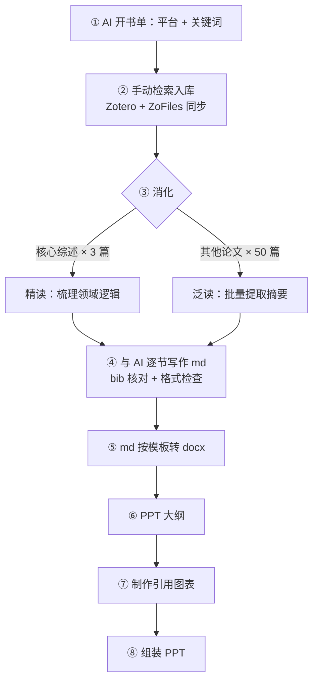

# 🏭 从文献检索到答辩 PPT：我的 AI 科研写作流水线

> **作者**：NeuraSailor × ClaudeCode

---

## 0. 写在前面

七月中领到科研训练任务书：一份文献综述（综合训练 I），一份开题报告（综合训练 II）。九月八日晚上，我把四份交付物拷进归档文件夹——综述 docx、综述汇报 PPT、开题报告 docx、答辩 PPT，齐了。


上一篇《让 Claude Code 读懂你的文献库》讲的是修路：把 Zotero 数据库翻译成 AI 能读的文件夹。这一篇讲跑全程——文献从检索到入库、从精读到成稿、从 Markdown 到 Word 再到 PPT，整条流水线长什么样。

先把结论放在前面：

> **AI 不是代写者，是流水线；人不是操作工，是流程设计者兼质检员。**

这套流程综述跑了一遍，开题又跑了一遍。下面把它拆开讲。

---

## 1. 流水线全景

先上全景图：



八个站，但分工只有两种：

| 环节 | 人做什么             | AI 做什么                        |
| ---- | -------------------- | -------------------------------- |
| 检索 | 定方向、筛选入库     | 开书单、列关键词                 |
| 消化 | 精读、划重点、定骨架 | 批量转格式、汇总摘要             |
| 写作 | 定逻辑、逐节审改     | 逐节起草、保持体例               |
| 引用 | 终审把关             | 自动编号、同源生成核对表、查格式 |
| 交付 | 定版式与图表风格     | 转 docx、渲染图表、组装 PPT      |

看出来了吗？**人守的是每一个「判断」关口，AI 包办的是所有「产能」环节。**下面逐站拆解。

---

## 2. 第 1-2 站：AI 开书单，人来选书

写综述最怕的不是写得慢，是方向从一开始就偏了。所以第一步我不是打开数据库，而是先问 AI：

```
你：我要写「深度强化学习机械臂抓取」方向的文献综述，
    推荐该搜的论文平台，并按子方向给我几组检索关键词。
```

AI 给出的东西通常像模像样：Google Scholar、arXiv、Semantic Scholar、IEEE Xplore，外加按「仿真到真实迁移」「状态表征」「抓取算法」「软体物体抓取」这些子方向分好的关键词组。到开题阶段，这个玩法更进一步——写到软体抓取分支时发现文献不够，我让 AI 盘点已入库文献、生成一份带优先级的补充清单：⭐ 必读、○ 参考、△ 备用，每档配好可直接复制的检索关键词块，我照单补检索就行。

但注意：**书单是 AI 开的，书是人挑的。**AI 的关键词只能保证「召回」，不能保证「相关」——它不知道你的课题里哪些分支是主线、哪些只是顺带一提。这个判断只能人来做，而它恰恰决定后面几十个小时花得值不值。

检索回来的论文，手动录入 Zotero 7。插件组合是 ZoFiles（把文献库同步成文件夹，上一篇的主角）+ Better BibTeX（管引用）+ Zoplicate（查重）。同步完成后，每篇论文在硬盘上长这样：

```
ZoFiles/机械臂科研/
├── 01.Deep Reinforcement Learning for Robotics…-2025/
│   ├── paper.pdf               ← 原文
│   ├── paper.bib               ← 引用信息
│   ├── paper.pdf-router.md     ← 全文 Markdown（pdf-router skill 转换）
│   └── notes/                  ← AI 对话记录 + 批注导出
├── 02.A Review of Robot Learning…-2019/
└── ……（共六十多个论文文件夹）
```

这个结构上一篇夸过了，这里只补一句：**`notes/` 里攒下来的 AI 对话记录，到写作阶段会变成金矿。**

---

## 3. 第 3 站：精读搭骨架，泛读填血肉

六十多篇论文，不可能也不需要篇篇精读。我的做法是二八开。

**精读三篇核心综述**——Tang 2025 的 DRL for Robotics 大综述、Kroemer 2019 的机器人学习综述、Sekkat 2024 的抓取综述。精读不是从头啃到尾，而是：边读边在 PDF 上划批注 → 导出批注 → 开着 AI 对话逐段讨论（对话自动存进 `notes/`）→ 最后整理成两样东西：领域**结构大纲**（Mermaid 思维导图）和**对我最有用的核心观点**（原文 + 翻译双语对照）。光其中一篇，就留下八段批注摘录、七轮 AI 对话、十二条梳理出的关键词。

这一步的产出直接决定综述的骨架：领域分几个分支、每个分支怎么演进、问题卡在哪里。

**其余五十篇泛读**。每篇只回答一个问题：它做了什么、和我的课题什么关系。pdf-router 先把 PDF 批量转成 Markdown 全文，再逐篇提取摘要翻成中文，最后汇编成一个 63 KB 的《核心论文 50 篇摘要汇编》——写作时的素材弹药库。

> **精读给你领域逻辑，泛读给你素材弹药：前者定章节，后者填内容。**

---

## 4. 第 4 站：与 AI 逐节写作，引用零容忍

接下来是重头戏：动笔。

我的写法不是「AI 帮我写篇综述」，而是**逐节讨论、逐节成文**：每一节先和 AI 把逻辑线聊清楚——讲什么、按什么顺序讲、引哪些论文——聊透了再让 AI 起草，我改完这一节才进下一节。开题阶段这个套路用得更狠：MDP 的设计要素 S、A、R、T、τ 一个要素一份讨论稿，五份聊完出整合报告，然后才是大纲、初稿、成稿。

所有稿件都是 Markdown，于是引出整条流水线里最重要的设计：**防错误引用机制。**

正文里从不手写 `[1]`、`[2]` 这种编号，只写 `[[zhang2025survey]]` 这样的 bib key 占位符，构建时交给脚本处理：

1. 按占位符首次出现的顺序自动编号；
2. 从同一份 bib 数据同时生成参考文献表和引用核对表——**编号和书目永远同源，想不一致都难**；
3. 每条引用带状态标签：`bib`（Zotero 库已核对）、`xref`（Crossref 已核对）、`arxiv`（arXiv API 已核对）、`canon`（顶会经典）、`draft`（原稿沿袭，待查）。

值得这么麻烦吗？值得。**引用错误是学术写作里成本最高、又最悄无声息的错误**——AI 起草的文本里混进一条张冠李戴的文献，你自己都发现不了。事实也证明这套机制值回票价：成稿后让 AI 按 GB/T 7714—2015 和学院格式说明做最后一轮引用核查，抓出 54 条英文作者姓氏未全大写、22 条会议论文缺析出符号，还有一条被引错的经典——ChainQueen 的出处长期被写成 CoRL，实际是 ICRA。

!!! note "为什么格式核查要等成稿后让 AI 再过一遍"

    逐节写作时 AI 是「当事人」，自己生成的引用自己看不出毛病；成稿之后让它切换成「审稿人」身份，拿着格式规范逐条对照，才查得动。所以别把这一步拖到提交前夜——查完还要留时间改。

---

## 5. 第 5 站：md → docx

学校收的是 Word，版式以学院下发的模板为准。md 硬转 docx 的坑谁都踩过：样式乱飞、页眉丢失、页码重排。这一站我全程只用 Claude 自带的 `/docx` skill，分三步：

1. **先让 AI 读懂模板**：用 skill 把模板 docx 转成 Markdown 喂给它——几号字体、标题怎么分级、图表怎么编号，先立好规矩；
2. **解包模板保版式**：再用 skill 把模板解包成 OOXML，页眉、节、页码这些版式设定原样保留，只把正文替换成从 md 转来的内容；
3. **特殊元素单独处理**：文中引用标号 `[n]` 统一转成右上角上标；正文里的 Mermaid 草图先渲染成正式图片再插入。

---

## 6. 第 6-8 站：PPT 三步走

汇报 PPT 我从不打开软件就直接开做，而是拆成三步。

**第一步，大纲。**每页按「要点 / 素材 / 讲述逻辑」三段式写清楚：这页讲什么、放哪张图表、和前后页怎么衔接。十页大纲写完，PPT 其实已经成了七成。

**第二步，图表。**PPT 的质量上限由图表决定。流程图、时间线、架构图用 Mermaid 写源码，`mmdc` 渲染成 2x 分辨率 PNG；复杂排版用 HTML 写，Edge 无头模式截图。所有图统一主题色、统一字号规范。图表源码全部归档，README 里记着再渲染命令——**图表是资产，不是一次性产物。**

**第三步，组装。**综述汇报 PPT 用 ppt-master skill 从模板生成可编辑的 pptx（第一版我用 python-pptx 脚本硬写，第二版换 ppt-master，效率和可维护性差了一个量级）；答辩 PPT 则是大纲和图表备齐之后快速组装——前两步做扎实了，组装纯粹是体力活。

---

## 7. 一点个人感受

复盘这两个月，最大的感受是：**AI 时代科研写作的门槛没变，变的是瓶颈的位置。**

以前瓶颈在产能——查格式、调版式、画图表，每样吃掉一晚上；现在这些全是流水线上的自动化站点，几十分钟出活。但检索该收哪篇、领域逻辑怎么分层、一条引用到底可不可信、实验失败说明了什么——这些判断 AI 一个都替不了，而它们恰恰是导师和评委真正在看的东西。

还有一个意外收获：因为整条流程都留下了痕迹——几十个版本的修改历史、引用核对表、文献补充清单、图表源码——这套东西本身成了可复用的资产。开题阶段复用综述的沉淀时，我已经明显感到第二遍比第一遍快。下次结题报告，直接三刷。

---

## 写在最后

如果你也面对综述、开题、结题这类「流程明确但工作量爆炸」的任务，我的建议是：

1. 让 AI 开书单，但自己检索、自己把关入库
2. 三五篇核心综述精读搭骨架，其余批量提摘要填血肉
3. 正文只写 `[[bib key]]` 占位符，参考文献表和核对表从同一份数据生成——引用错误零容忍
4. 转 Word 前先让 AI 读模板，再解包保版式，别硬转
5. PPT 拆成大纲、图表、组装三步，图表源码当资产归档

工具会换代，流水线会重搭，但「人守判断、AI 出产能」这个分工，会长期成立。

*这里是「唱唱反调」——AI 跑流水线，人守闸门。*
